# Requirements Consolidator

An app concept for opening large SysML v2 / MSOSA requirement projects, finding near-duplicate requirements mechanically first and with AI late, showing metrics for both, and treating everything as a human-verifiable draft reviewed through four lenses (SE, PE, UX, NU) before it feeds document authoring.

This repository holds the research, the design boards, the generator that makes them, a clickable prototype of the screens, and the first working code: the input layer, a reference server for shared review, and the library behind the AI data-handling gate.

New agents: read [Capabilities](docs/CAPABILITIES.md), then run `python3 tools/doctor.py` after setup. For an actual comparison review screen, [tools/review](tools/review/README.md) builds a portable workspace from validated datasets and engine output. Its human review notes can be downloaded and restored; all results remain drafts. The sample prototype and its token-based shared decisions are a separate workflow.

## What it looks like

Everything on these screens is a synthetic sample. Click a picture for full size; the guide explains the design: [`docs/GUI_DESIGN_GUIDE.md`](docs/GUI_DESIGN_GUIDE.md). The fonts are bundled with the prototype, so the pictures show the real typefaces.

<a href="docs/images/prototype/03_home.png">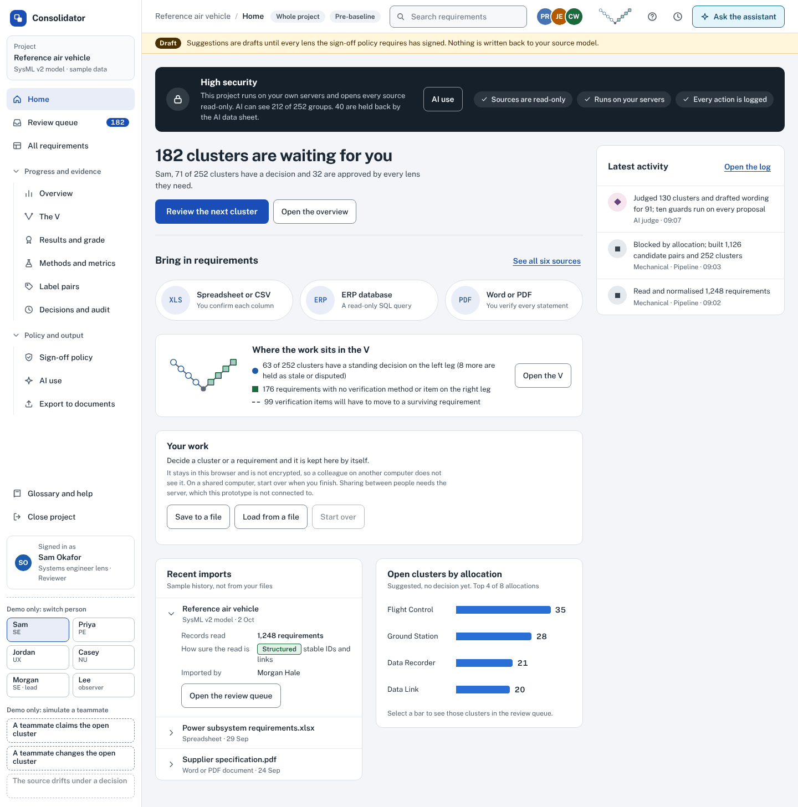</a>
<a href="docs/images/prototype/07_cluster_review_six_wordings.png">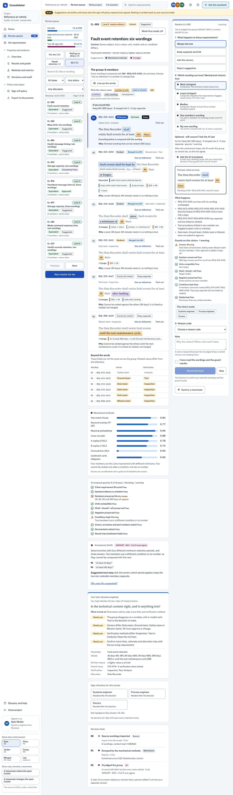</a>
<a href="docs/images/prototype/08_wordings_lined_up.png">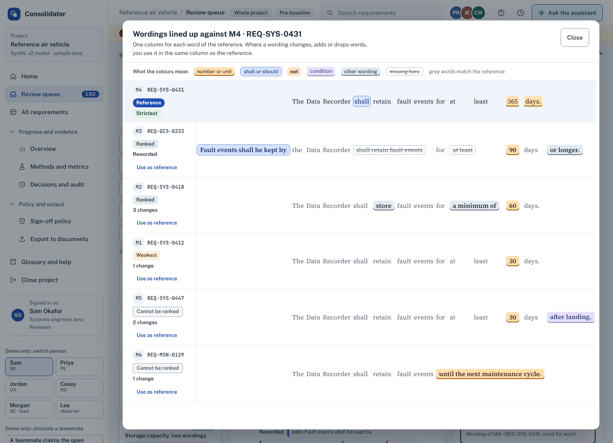</a>
<a href="docs/images/prototype/20_the_v.png">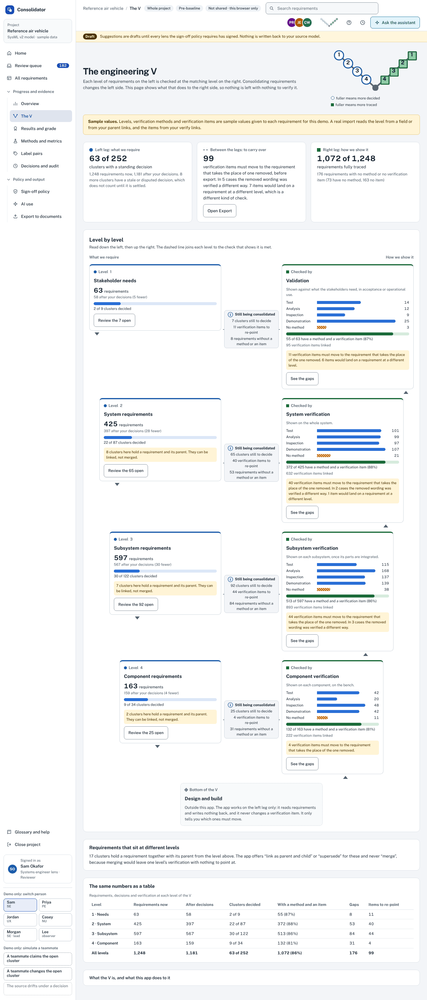</a>
<a href="docs/images/prototype/17_results_and_grade.png">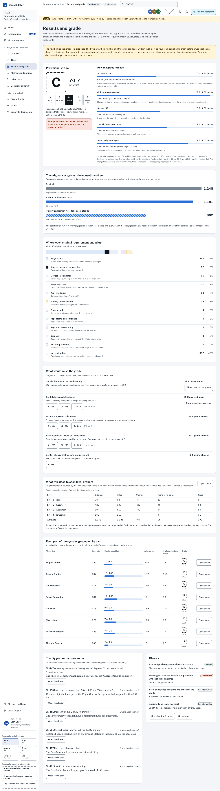</a>
<a href="docs/images/prototype/18_hand_off_waiting.png">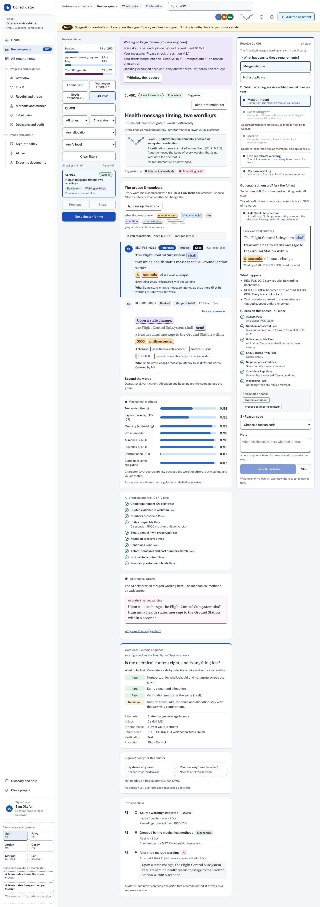</a>
<a href="docs/images/prototype/23_label_pairs.png">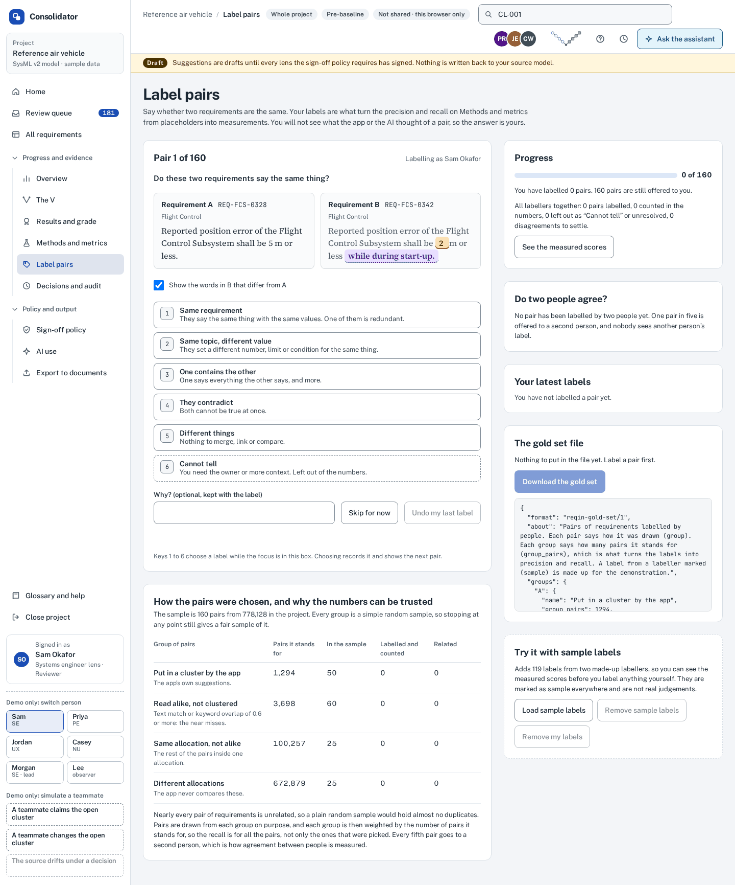</a>
<a href="docs/images/prototype/24_one_requirement.png">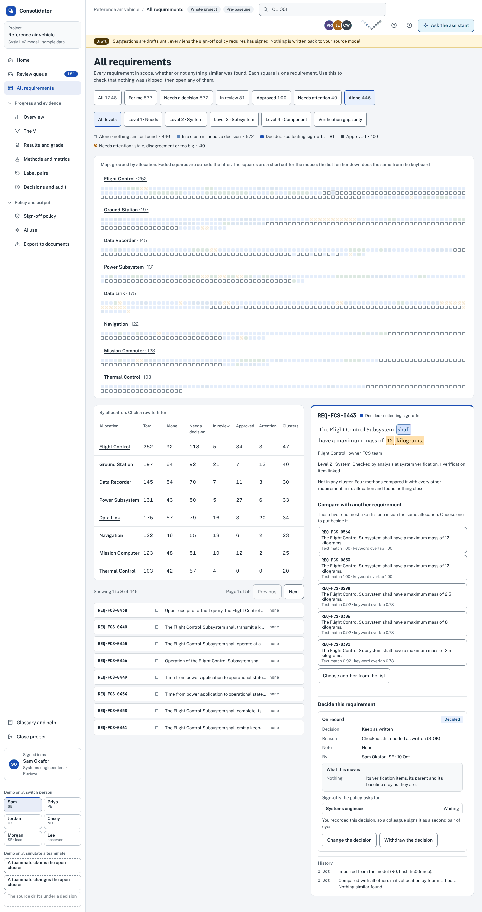</a>
<a href="docs/images/prototype/25_trace_map.png">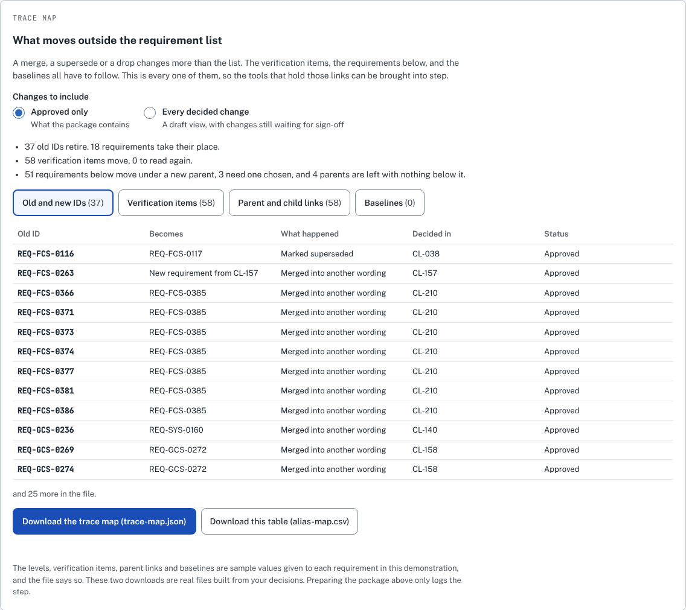</a>
<a href="docs/images/prototype/27_ai_use.png">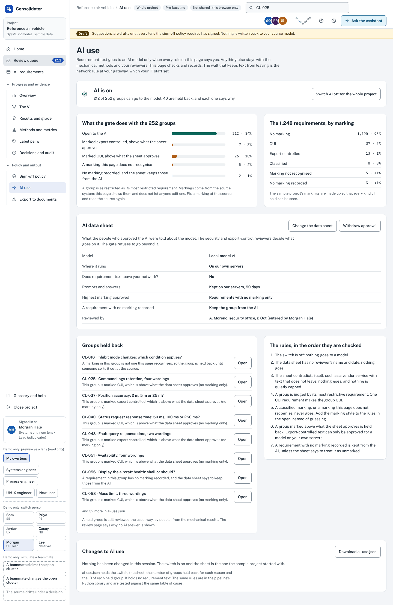</a>
<a href="docs/images/prototype/28_held_group_review.png">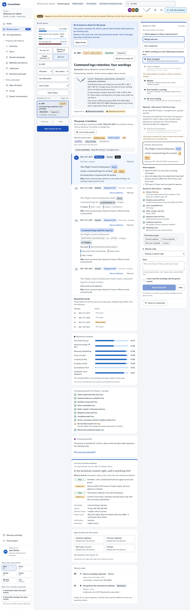</a>
<a href="docs/images/prototype/09_all_requirements.png">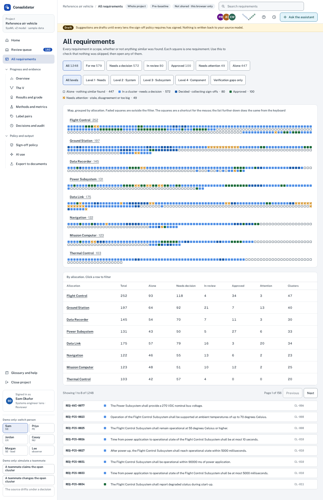</a>

The twelve design boards (Excalidraw files, rendered here because GitHub cannot show them):

| | | | | |
|---|---|---|---|---|
| [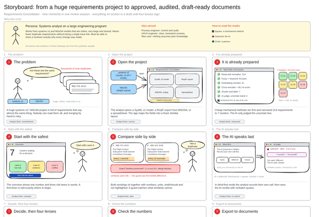](docs/images/boards/01_storyboard.png)<br>Storyboard | [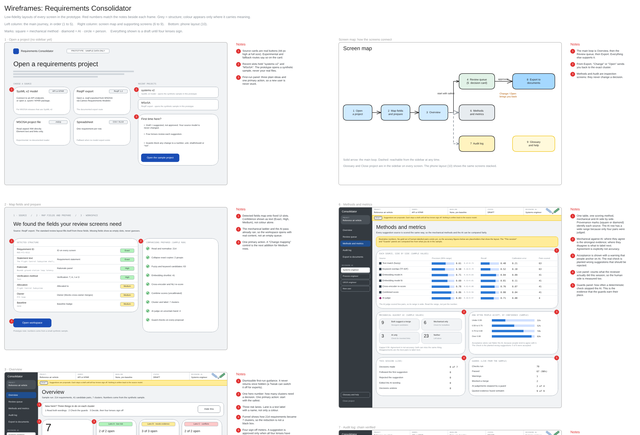](docs/images/boards/02_wireframes.png)<br>Wireframes | [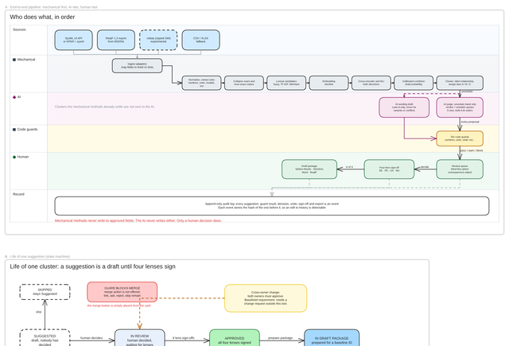](docs/images/boards/03_system_flows.png)<br>System flows | [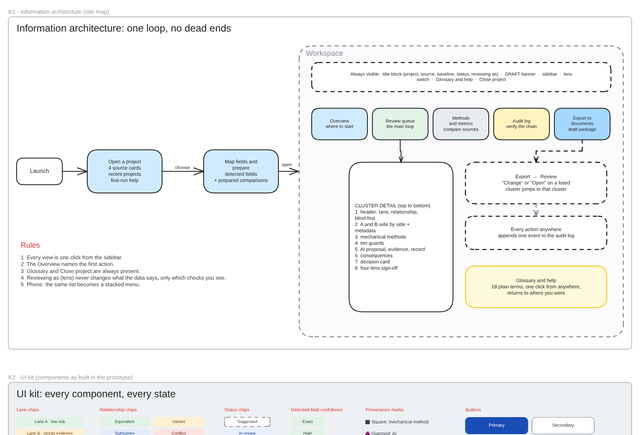](docs/images/boards/04_ui_kit_and_IA.png)<br>UI kit | [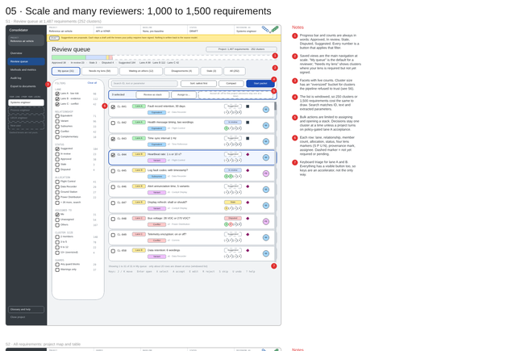](docs/images/boards/05_scale_and_multiuser.png)<br>Scale |
| [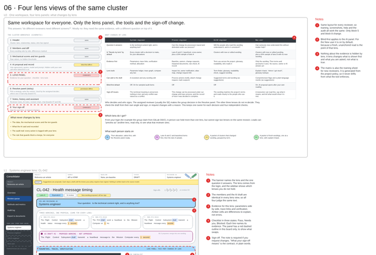](docs/images/boards/06_lens_views.png)<br>Four lenses | [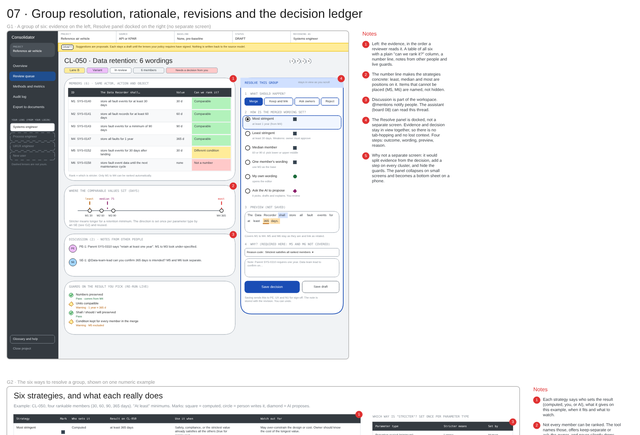](docs/images/boards/07_group_and_decisions.png)<br>Group decisions | [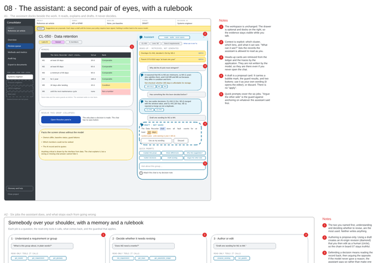](docs/images/boards/08_assistant.png)<br>The assistant | [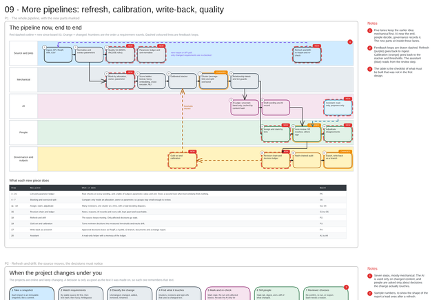](docs/images/boards/09_more_pipelines.png)<br>Pipelines | [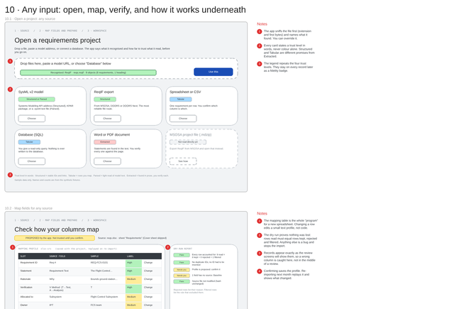](docs/images/boards/10_input_any_source.png)<br>Any input |
| [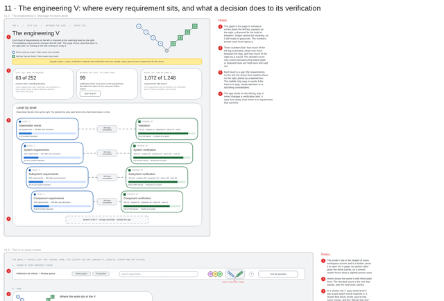](docs/images/boards/11_the_engineering_v.png)<br>The engineering V | [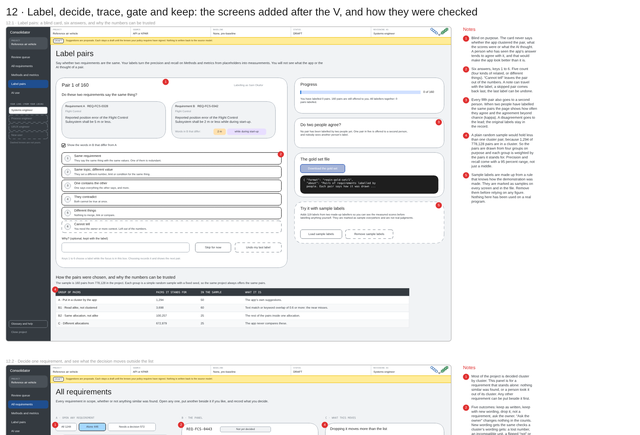](docs/images/boards/12_newer_screens.png)<br>Labelling, one requirement, AI use, keeping the work | | | |

| Folder | What it is |
|---|---|
| `docs/Requirements comparison app research.md` | The research report. Appendix A = how the app reads any input. Appendix B = how the Excalidraw boards were made. |
| `docs/V_MODEL.md` | The engineering V: where the app shows it, how every number is counted (`reqin vee` uses the same rules), what is sample and what is not. |
| `docs/COMPARE_FORMAT.md`, `docs/COMPARE_RESULTS.md` | The comparison engine's output (four files and a manifest, `reqin-compare/1`), every rule it applies and what it does not do; and how well it did on made-up requirements and on 250 pairs labelled by a language model, with every disagreement listed. Both are generated from the code and a test fails when they go stale. |
| `docs/GOLD_SET.md`, `docs/KEEPING_THE_WORK.md`, `docs/AI_DATA_HANDLING.md`, `docs/ACCESSIBILITY.md` | How the precision and recall numbers become real (labelling pairs), what the prototype keeps and checks before a saved file replaces anything, what the AI gate is and is not, and what the accessibility checks cover and do not. Each ends with what has **not** been checked. |
| `docs/GUI_DESIGN_GUIDE.md`, `docs/images/` | How to design the review screens, how to make the Excalidraw drawings clear and good-looking, and the screenshots and board renders (regenerate with `prototype/shots.py` and `excalidraw_generator/render.py`). |
| `reqin/` | **Working code.** Reads SysML v2 (files and REST), SysML 1.x / MSOSA project files (`.xmi`, `.mdzip`), ReqIF (MSOSA / DOORS), DOORS Next (OSLC), Digital.ai Agility, Jira, Polarion, Jama Connect, Sparx Enterprise Architect (through its SQL repository), Excel/CSV, SQL, Word and PDF into one canonical model (`docs/SOURCE_EXPORTS.md` lists, per tool, what the vendor documents it can export and which route here reads it); can watch a folder of exports. Compares what it read mechanically (`reqin compare`: groups requirements that say the same thing, and lists pairs that differ in one stated way, each with the rule that said so; **no model**; the output is a draft for a person). Also a reference server for shared review (`SERVER.md`: no silent overwrite, roles, sign-offs, a record that verifies; the prototype connects to it when served from its address and signed in with a token) and the AI gate library (`aigate.py`). `INPUT_LAYER.md` is the design, `CONNECTORS.md` is how to finish and write connectors, `GUI_CONTRACT.md` is what any screen may rely on (one dataset folder, never a file) plus the 14 datasets it must pass. |
| `connector_template/` | A working, tested starting point for your own connector, with five `TODO(agent)` seams and a ready prompt for an agent. Installs as its own package. |
| `excalidraw/` | Twelve Excalidraw boards: storyboard, wireframes, flows, UI kit, scale, lenses, group decisions, assistant, pipelines, any-input, the engineering V, and the newer screens (labelling, one requirement, AI use, keeping the work, how it was checked). **Generated; do not edit by hand.** |
| `excalidraw_generator/` | The Python that produces the boards, with `EXCALIDRAW_GUIDE.md` (recipes, definition of done, prompts for an agent). |
| `prototype/` | Clickable prototype of the screens (one page, built from `parts/`). Open and Import screens show real `reqin` output; everything else is synthetic. A picture of the product, **not a starting point for code**: its page is generated and its numbers are typed in. See `prototype/README.md`. |
| `design/` | For building real screens: the design language as data (`tokens.json`, and the generated `tokens.css`), a procedure and small scripts for going from a picture of a screen to components in a site's own look (`ui_from_image/`), and a small plain screen that shows a dataset and passes every check (`reference_viewer/`). See `design/README.md`. |
| `tools/gui_checks/`, `docs/GUI_TEST_HOOKS.md`, `docs/SCREEN_DATA_MAP.md`, `docs/agent_prompts/build_the_gui.md` | What shows that a screen is bound to its data: a scan of its source for typed-in data and literal colours, and a probe that opens the fourteen test datasets in a real browser and compares the screen with the files; the marks a screen carries so one probe can check any screen; which dataset field fills which part of which screen; a drift gate (`golden.py`) that fails any change to a screen the owner has approved; and a prompt for any agent to build a screen with them, including how several agents share the work. |
| `tools/` | `check_no_real_data.py`, the tripwire that keeps real program data out of the repo, and the tests that keep the licence files, the board and screenshot pictures, the Markdown links and the GitHub workflow honest. `tools/mutation/` breaks the code on purpose, one change at a time, to show that the checks notice (see its README for what the last full run found). |
| `Containerfile`, `.github/workflows/ci.yml`, `.gitlab-ci.yml`, `Makefile` | Podman/Docker image and CI (GitHub Actions and GitLab). `make check` runs what CI runs. |
| `CONTRIBUTING.md`, `SECURITY.md` | How to change things safely, and how to report a vulnerability privately. |

## Quick start

```bash
python3 -m venv .venv && . .venv/bin/activate
pip install -e "reqin[test]"
make check          # guard + the reqin tests + the connector template + rebuild all twelve boards and the prototype page, confirm they are identical
```

Try the CLI on your own export (read-only; the source file is never modified):

```bash
reqin sniff    export.reqif
reqin propose  export.xlsx > profile.yaml     # a PROPOSED mapping: edit it, it is not trusted until you do
reqin import   export.xlsx --profile profile.yaml --out reqs.jsonl
```

In a container (nothing from the host is writable except what you mount; no network needed for file sources):

```bash
make image
podman run --rm --network=none --userns=keep-id --user "$(id -u):$(id -g)" \
  -v "$PWD/exports:/data:ro,Z" -v "$PWD/out:/out:Z" requirements-consolidator/reqin:dev \
  import /data/export.reqif --out /out/reqs.jsonl
```

## Real program data

**Do not commit real requirements, exports or models.** Not in `data/`, not "temporarily", not in a branch.
`.gitignore` blocks the usual file types, and the CI guard job (`guard:no-real-data` on GitLab, `guard` on GitHub) fails the pipeline if one gets in anyway.
The single exception is `reqin/tests/fixtures_approved/`, for anonymised excerpts that your security / export-control reviewer has approved, each recorded in `APPROVALS.md`.
To also scan for your own program code names and number patterns, set a CI/CD variable (GitLab) or repository secret (GitHub) named `FORBIDDEN_TERMS` (one regex per line). Keep that list out of the repo.

## What has and has not been checked

| Checked | How |
|---|---|
| `reqin`: 1,244 tests pass | On one Python in the working environment (about a minute). The clean-environment runs on Python 3.11, 3.12 and 3.13 were last made when there were 492 tests and **were superseded by passing GitHub CI runs of the current suite on Python 3.11, 3.12 and 3.13 on 2026-10-21.** Node.js is on the path (it runs the page-against-library comparison of the AI gate; that comparison skips itself without Node) and LibreOffice is not (an optional extra test runs where it is installed). The connector template's 9 tests pass as shipped. |
| The comparison engine does what its rules say | `reqin/tests/test_compare.py`: one test per rule and per number-reading case, the output files checked by `reqin check-compare`, all 14 contract datasets run through it, and the same answer in any input order. `tools/mutation/compare.py` makes 199 deliberate changes to the engine (each rule removed or reversed, each limit, each unit, each way a pair of different requirements was once merged): 197 noticed, 2 harmless and explained. The first full run noticed 192, listed 1 as harmless and left 6; five tests were added for five of those and the five changes, re-run on their own, were all noticed; the sixth was judged harmless by reading the code. The full run has not been repeated since. [`docs/COMPARE_FORMAT.md`](docs/COMPARE_FORMAT.md) |
| The comparison engine against pairs somebody else labelled | **Made-up requirements and a language model's labels, never real ones.** On a corpus its author generated it merged no two requirements that differ (0 of 1,017 merged pairs) and found 78.5 % of the pairs that mean the same, almost all of those missed being wordings outside its short vocabulary. On 100 pairs written and labelled afresh and scored once (a Claude model, the same family as the assistant that wrote the engine) it agreed with the label on 45: 62 % of the pairs the writer said can be read from the words, 8 of 40 of those that need meaning, and it said EQUIVALENT only when the label agreed (4 of 4) while clustering 4 of the 25 pairs labelled EQUIVALENT. Another 150 pairs were used to fix bugs and are not independent. [`docs/COMPARE_RESULTS.md`](docs/COMPARE_RESULTS.md) lists every disagreement and every known gap. |
| The live connectors' tests bite | 21 deliberate breaks (a leaked secret, a redirect to another host, TLS off, a write verb, paging that stops after page one, caches removed, settle time ignored, a `delete` in the DOORS script ...): 18 caught at once, 3 exposed missing tests, which were added and are now caught. 20 more on the dataset layer: all caught. 178 more on the connectors written from vendor documentation (Jira, Polarion, Jama, the `.xmi` reader, Agility, the OSLC configuration, the `sql` guard): the first run missed 56, tests were added for 54 of them, one was removed as redundant code and one explained as harmless, and a second full run noticed 177, 1 harmless, none missed |
| Boards rebuild byte-for-byte; structurally valid | `make boards`, clean environment, standard library only |
| Prototype, static | The committed page equals a fresh build. `verify.js` resolves every template hole across about 1,000 states (0 issues) and holds the rules to their promises: the grade rule, the V's counts against Results, the gold-set estimator against exact answers, every pair counted in several hundred random sets, the AI gate against its table of cases, and the checks on a saved file. |
| Prototype, in a browser | Ten test files, each run at 1440, 900 and 390 px: 30 runs, all passing (about 17 minutes together): Open and Import (44 checks), the side bar, Home and the wording comparison (55 to 56), dispositions, the AI-last step, hand-offs, metrics and results (73), the engineering V (79 to 81), label pairs (74 to 75), one requirement at a time (86), the trace map (73), keeping the work (106), AI use (75) and accessibility (224). The metrics scores other than the labelled table are placeholders, and the grade rule is a proposal. The older flow scripts only print what they see. |
| Scale | `node scale.js` builds a project 20 times the sample (24,960 requirements, 5,040 clusters), draws every page, counts the gold-set pairs, and writes and reads back the project file and the trace map, each against a limit about three times what a laptop needs. It runs twice: with the sample repeated (the pair counting takes 1.5 s; the first version took 204 s) and with a varied shape, every wording different and a few very large clusters (9.6 s). At 49,920 requirements the varied shape took 42 s for that one count. **Both are made up: they test how fast, not how well, and a real corpus has its own shape.** |
| Accessibility | axe-core (WCAG 2.2 AA and best-practice rules) plus checks written for this page, on every page and several states at three widths, with no violations: contrast as drawn, field edges, the keyboard, reflow at 320 px, reduced motion, chart colours checked for red-green colour blindness. Nine deliberate mistakes were each caught by the check made for them. **No screen reader, switch device or voice control has been used with it and no person with a disability has tried it;** Chromium only; the four lens colours fail the colour-blind check for two pairs (the lens is always named in words). [`docs/ACCESSIBILITY.md`](docs/ACCESSIBILITY.md) |
| AI gate | The page and the Python library (`reqin.aigate`) give the same answer on one shared table of cases and on tens of thousands of generated inputs (the first such comparison found a real difference, which was fixed). It is a check in the application, **not a security control**: the wall is the network rule at your gateway. [`docs/AI_DATA_HANDLING.md`](docs/AI_DATA_HANDLING.md) |
| Keeping the work and the server | The prototype keeps decisions, sign-offs, hand-offs and labels in the browser and can save and load a file after checking it (106 browser checks). It is **not shared between people and not encrypted**. The reference server (`reqin/SERVER.md`: no silent overwrite, roles, sign-offs, a SHA-256 record) has 80 tests; **the page connects when served from the server and signed in with a token.** [`docs/KEEPING_THE_WORK.md`](docs/KEEPING_THE_WORK.md) |
| The checks bite | 267 deliberate changes in `tools/mutation/` (the page's logic, the AI gate, the gold set, the trace map, saving, accessibility and the reference server): 263 noticed, 4 change nothing a person can see (each explained), none missed. 17 of the 93 AI-gate changes were noticed only because the page crashed. A further 178 changes to the connectors (`connectors.py`): 177 noticed, 1 harmless, none missed (the first run had missed 56 and tests were added). A further 20 changes to the drift gate (`golden.py`): 20 noticed (the first run had missed one, the noise threshold, because the test read the number from the code it was checking; the test was fixed). [`tools/mutation/README.md`](tools/mutation/README.md) |
| The drift gate for approved screens | `tools/gui_checks/golden.py` is checked on pictures drawn for the test (what counts as a change, the tolerance, a size change, a missing golden or picture refused, an approved screen nobody photographed failing `compare-all`, what `approve` stores) and, in Chromium, on the reference viewer (two pictures of one screen are identical; a real change to its stylesheet fails the gate); 20 deliberate changes, all noticed. **Not checked:** it has not been used by an owner on a real screen (nothing is approved here and no pictures are committed); its pictures differ between machines, so goldens must be made and checked in one place; and the tests need Pillow. The GitHub `guard` job now installs Pillow, numpy, reqin (and so pyyaml) and the pinned Playwright with Chromium, so the picture, dataset and browser tests in `tools/` run there instead of skipping; the GitLab `guard:no-real-data` job (a slim image with no browser) installs all but the browser, and the browser tests run in `prototype:browser`. `tools/test_ci_installs_test_dependencies.py` and a check in `tools/test_workflows.py` fail if an install is lost, so these tests cannot be skipped without a sound. In a clean environment with reqin, Pillow, numpy and the pinned Playwright package but no Chromium (the pinned Chromium cannot be downloaded where this was written): 463 passed, 112 skipped, 0 failed; the browser tests ran only against Chromium 153 in a full sandbox (all passed after one test was updated, see below). The first run with the pinned Chromium 141 on GitHub is the pull request that added it; GitLab is unrun. [`docs/GUI_TEST_HOOKS.md`](docs/GUI_TEST_HOOKS.md) |
| The design kit and the checks for real screens | `design/tokens.css` is what `tokens.json` produces, and the tokens name 88 % of the colour uses in the prototype (14 tests). Every field and code name in `docs/SCREEN_DATA_MAP.md` exists in real `reqin` output or in the page's source (7). The picture-to-components scripts (a block cutter, a palette reader, a reader of a page's computed colours, fonts and component states, a colour mapper, a component-spec checker) give the known answers on pictures and pages written for the test and on the prototype's own screenshots, and fail when broken on purpose (33 + 10 tests). The reference viewer (`design/reference_viewer/`) passes all of the probe's checks on the 14 test datasets, through the address and through the file inputs, and the probe fails at the check named for it on each of 19 deliberate breaks of the viewer, among them a count typed in, a warning dropped, a link kind renamed, a list that is not windowed, a damaged dataset shown instead of refused, a font file missing, and a screen that keeps the first dataset on screen; the source scan fires on each rule and stays quiet on a near miss (63 + 25 tests). [`docs/GUI_TEST_HOOKS.md`](docs/GUI_TEST_HOOKS.md) |
| Guard trips on what it should | 13 tests, including the real-export file types, data folders, size, missing approval entries, files not yet added to git, and that only three exact paths are exempt (the reviewed DOORS script and the two Enterprise Architect query files; any other `.dxl` or `.sql` is still refused) |
| Pictures, links and workflow stay true | 545 tests in `tools/` (544 pass, in about four minutes; one needs an IPv6 loopback and skips on a machine without it; the guard's tests included). Every board picture and the prototype screenshots must have been made from the current board or page; every relative link in the Markdown files must resolve; the licence files must agree and every bundled font family must ship with its licence and a notice; the prototype page must make no request to an outside host; the GitHub workflow must keep a read-only token, pinned actions and no `pull_request_target`, and name only files that exist; the browser-test runner must fail the job when a test fails; and every deliberate-change script must still match the code it changes. Each check was shown to fail on a deliberate break. Re-run on 24 October 2026 in a shared cloud sandbox after the drift gate was added: 570 tests collected, 567 passed, 2 skipped, 1 failed. The failure, `tools/test_ui_from_image_browser.py::test_hover_and_keyboard_focus_changes_are_measured`, was a stale expectation: Chromium 153 reports a focus ring's width as `3px` even while its style is `none` (older builds reported `0px`), so the width is no longer a change on focus. The test now requires the style to change from none to solid and the width to be 3px, whichever way the browser reports it. |
| Secret scanning | gitleaks (pinned, checksum-verified) and a private-term list kept outside the repository run before each commit and in CI over the whole history; their tests show a planted secret and a planted term are stopped, and that a term inside a file or branch name is printed as `[term]`, never as itself (`tools/test_denylist_masking.py`; the first version printed such a name). The term list and the `DENYLIST` secret are yours to supply. [`docs/SECRET_SCANNING.md`](docs/SECRET_SCANNING.md) |
| `.gitlab-ci.yml`, `.github/workflows/ci.yml` | Both pass their platform's JSON schema; the GitHub file also passes `actionlint` 1.7.7. Each job's commands were run locally. GitHub CI ran on commit `02ac345` on 2026-10-21: Python 3.11–3.13, Chromium, WebKit, scale, boards and guards passed; the private-term job failed because `DENYLIST` was absent, and the allowed-to-fail Firefox job reported five keyboard failures. GitLab execution remains unverified. See the [run](https://github.com/gitSITTI/Avana02/actions/runs/39619948023). |
| **Not checked** | Anything with real people or real data: the prototype has been used by nobody on a real program, and its screens use a synthetic sample. The `Containerfile` has not been built (no container engine daemon was available where it was written). **Any connector against a real system.** `sysml_api`, `oslc_rm`, `agility`, `jira`, `polarion` and `jama` are fake-server-tested only (`reqin connectors` says so); the `.xmi` / `.mdzip` reader has only read files I wrote from the vendor's documentation, and the Enterprise Architect query pack has run only on a made-up SQLite database whose column names are recalled, not read from a real repository; the Jama token helper (the only code here that sends a POST) has never run; Codebeamer is deliberately not built (its usage terms); the DOORS 9 script has never run in DOORS; OAuth / form sign-in is not built. Reading real MSOSA, DOORS or SysML v2 exports: all fixtures are synthetic. **The comparison engine has never run on a real requirements set**, no person has labelled a pair for it (the labels are a language model's), its output format has been read by nobody but its author, and no real-user accuracy claim is made. The portable review workspace now reads its output and has been checked with synthetic datasets. **The agent brief for building screens (`docs/agent_prompts/build_the_gui.md`) has been followed by no agent except the one that wrote it, and the rules added to it since (fix before you report, do not invent to fill a gap, own worktree and branch, lock the approved look) have not been followed by any agent on a real task;** the probe and scan have also run on the new portable review workspace (552 checks passed); the picture-to-components scripts have run only on made-up pictures and the prototype's screenshots, never on a real site or a real GUI export, and the block cutter finds candidate blocks, not components. Opening the boards in the live Excalidraw app. Real-user accessibility testing. Python 3.10 (not supported; 3.11+ is). |

## Next steps (not done)

1. Add one anonymised real export per source under `reqin/tests/fixtures_approved/` and run the conformance suite on it. This is the first check that matters.
2. Run the mechanical comparison engine (stages 1 to 4 in the report) on one approved evaluation set outside this repository and have two people label pairs: the measured figures are from made-up requirements. The portable screen in `tools/review/` now reads engine output; connecting those drafts to shared sign-offs and later model-assisted stages remains to be done.
3. Build the real UI around imported datasets and comparison output. Token-based shared decisions are already connected in the prototype; the requirements shown there remain synthetic.
4. Run both CI files on their platforms, add the `DENYLIST` secret (GitHub) or `DENYLIST_FILE` variable (GitLab) and your own term list, and put the network rules in front of any model host (`docs/AI_DATA_HANDLING.md`).
5. Have people use the prototype with a screen reader and with the keyboard alone, and label real pairs with two labellers.

## License and contributing

Apache License 2.0: see [`LICENSE`](LICENSE) and [`NOTICE`](NOTICE). Copyright 2026 gitSITTI. Some bundled files are not covered: `prototype/project/support.js` is a copy of React (MIT) and `prototype/project/fonts/` holds three font families (SIL Open Font License 1.1). Both are listed with their licences in [`THIRD_PARTY_NOTICES.md`](THIRD_PARTY_NOTICES.md).

This is a research prototype and comes **as is**, without warranty (see sections 7 and 8 of the licence). Read "What has and has not been checked" above before relying on it: no connector has been run against a real MSOSA, Teamwork Cloud, DOORS, Agility, Jira, Polarion, Jama or Enterprise Architect system.

Secrets and private names are checked before every commit and again in CI over the whole history (gitleaks at a pinned, checksum-verified version, plus a private-term list that is kept outside the repository): [`docs/SECRET_SCANNING.md`](docs/SECRET_SCANNING.md).

Contributions are accepted under the same licence: see [`CONTRIBUTING.md`](CONTRIBUTING.md). Never commit real requirements, exports or models; the guard described above exists to stop that, and a pull request that trips it will not be merged. Report vulnerabilities privately: [`SECURITY.md`](SECURITY.md).
