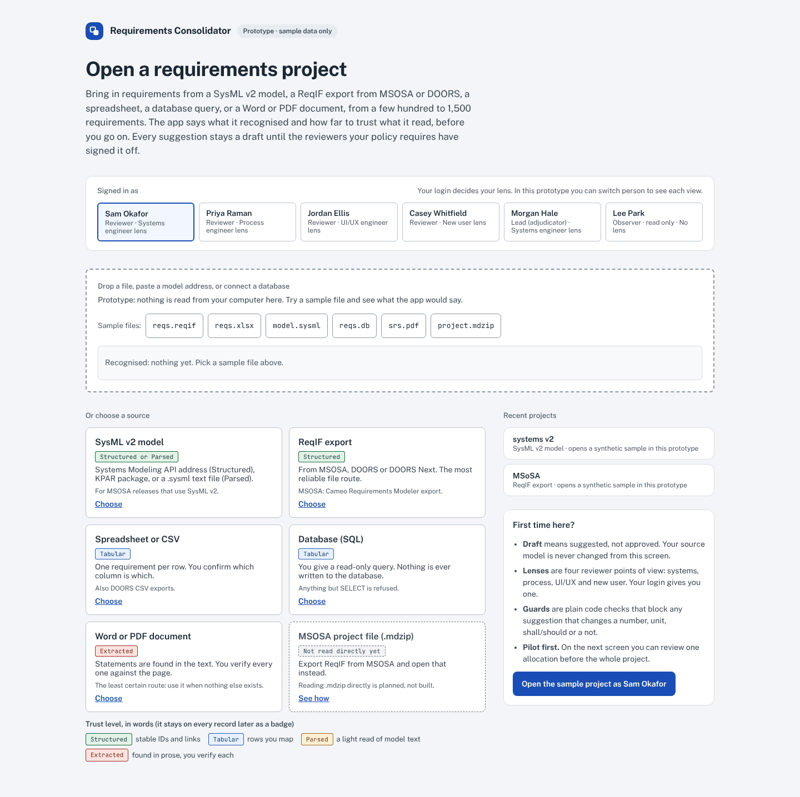
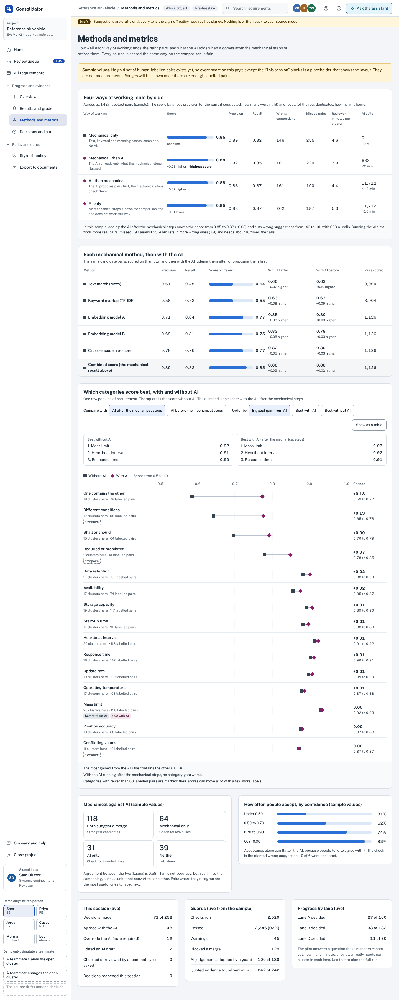

# GUI design guide

How to design the review screens for a requirements tool that must work with *any* source, how to go from a drawing to a working screen, and how to make the Excalidraw drawings clear and good-looking.

Read this with three other things in the repository:

| Read | For |
|---|---|
| [`reqin/GUI_CONTRACT.md`](../reqin/GUI_CONTRACT.md) | **What data the screen gets.** One folder format, never a file. This guide never repeats it; it says how to show it. |
| [`excalidraw_generator/EXCALIDRAW_GUIDE.md`](../excalidraw_generator/EXCALIDRAW_GUIDE.md) | **How the boards are built** (the Python, the widgets, the recipes). Section 7 below is the craft on top of it. |
| [`prototype/README.md`](../prototype/README.md) | **The clickable prototype** these pictures come from. |

All screens in the pictures use a synthetic sample. Nothing here has been tested with real users, and the prototype has not had a formal accessibility audit (see section 10).

---

## 1. A tour in eight pictures

Each picture is a real screenshot of the prototype. Click one to see it full size. All 19 are in [`images/prototype/`](images/prototype/).
The prototype bundles its fonts (Public Sans for the interface, Source Serif 4 for requirement wording, JetBrains Mono for IDs; all under the SIL Open Font License), so the pictures show the real typefaces.

**Open: choose where requirements come from.** Six source cards, each with a trust level in words. A drop zone says what a file would be recognised as, before anything is imported.

**Home: what needs you, and where to bring requirements in.** One count and one button lead. Below them: the three most common ways in (spreadsheet, database query, document), an expandable list of recent imports, a bar chart of where the open clusters are (select a bar to open them) and the latest activity. A dark band at the top says, in words, how the project handles security.

**Cluster review: every wording against one reference.** The strictest wording is the reference by default; choose another with "Use as reference". Grey words match it. Only what differs is coloured (numbers and units, shall/should, "not", conditions, other words), and a chip under each wording says the difference in plain words ("365 → 60", "drops at least"). Words the reference has and a wording lacks show as dashed, struck-through ghosts instead of a blank.

**Line up the words: the same comparison as columns.** One column per word of the reference, so a changed number sits directly under the number it replaces. It opens in a wide window because it needs the width; Escape closes it and focus returns to the button that opened it.

**All requirements: a map, not a table.** Each square is a requirement, grouped by what the data says (here, allocation). Faded squares are outside the filter.

**Methods and metrics: show the numbers for both approaches, and for the order they run in.** Mechanical only, the AI after the mechanical steps, the AI before them and the AI alone are scored the same way, side by side. A second table does the same for each mechanical method, and a third shows which categories of requirement score best with and without the AI. A banner says the figures are placeholders until a human-labelled set exists.

**Results and grade: does the consolidated set hold up against the original?** A letter with its score, and under it the five parts the score is made of, each with its points and the sentence that says what it checks. Next come the counts (the original, after the decisions so far, and if every suggestion were taken), where each original requirement ended up (all of them add up to the original count), and what would raise the grade, largest first, with a button that opens the clusters concerned. The rule is a proposal and the page says so. A provisional grade has a dashed border until 90 percent of the clusters are decided.

**Sending a cluster to a teammate.** From any cluster you can ask someone for a second opinion before you record, hand them the decision, or ask them to review one you recorded. The sender sees who it is waiting on and recording pauses; the teammate sees what was asked and what the sender was about to do. A "second opinion" only counts as "checked by" if you then record what they agreed to.

On a phone the side bar becomes a block of buttons at the top and everything else stacks: [Home](images/prototype/15_phone_home.png), [the six wordings](images/prototype/16_phone_six_wordings.png) and [the grade card](images/prototype/19_phone_results.png).

---

## 2. Five questions every screen must answer

A person who is not a systems engineer should be able to answer these without help. If a screen cannot answer one, redesign the screen, not the help text.

1. **Where am I?** The side bar marks the current place; the page title says it again; the top bar names the project, the page, the scope and the baseline.
2. **What am I looking at?** A one-line sentence under the title, in plain words, before any table.
3. **How far can I trust it?** Every value that was guessed, inferred or written by an AI says so in a word (section 5).
4. **What can I do next?** One primary button per screen. Optional actions look different (dashed or secondary).
5. **How do I check it, and how do I undo it?** Every record can be traced to its source, and every decision can be undone or is logged.

---

## 3. Screen by screen

| Screen | The question it answers | Contract rules it relies on |
|---|---|---|
| Open | What can I open, and how will it be read? | 5.3 (trust in words), 5.7 (several sources) |
| Check the mapping | Did the tool understand my columns? Which slots stayed empty? | 5.1 (never hard-code), 5.2 (say what is missing) |
| Home | What needs me, and where do I bring more requirements in? | 5.2 (lists built from values present), 5.3 |
| Overview | How did the list narrow, and how far has sign-off got? | 5.4 (counts add up), 5.5 (any size) |
| Review queue | What is waiting for me, and what is waiting for others? | 5.2 (lists built from values present) |
| Cluster review | How do these wordings differ from the reference, and what survives if I merge? | 5.3, 5.8 (text is text) |
| All requirements | What is in this project, grouped how the data groups it? | 5.2, 5.5 |
| Methods and metrics | How good is each method, and what does the AI add before or after it? | 5.4 (nothing hidden) |
| Results and grade | Does the consolidated set hold up against the original, and what would raise the grade? | 5.4 (counts add up) |
| Decisions and audit | What was decided, by whom, and has anything changed since? | 5.6 (always jump back) |
| Sign-off policy | Who must sign what, and why? | none: this one is about the process, not the data |
| Export | What goes into the draft package, and what is left out? | 5.4 |

A new screen should start from the same question: write the question in the title, then show only what answers it.

---

## 4. Layouts that survive any size and any source

- **Window long lists.** Show the first screenful and page or scroll the rest. Never assume the sample's size; the 14 test datasets include an empty one, a minimal one and one with 50,000 records.
- **Build filters from what is present.** A filter for "allocation" exists only if some record has an allocation. The lists of values come from the data, not from a fixed list in the code.
- **Say "not provided by this source".** A blank is ambiguous (empty? lost? hidden?). Use the words.
- **Counts are always on screen and always add up.** Read = kept + rejected + filtered, shown as numbers, not as a progress bar.
- **No horizontal page scroll** at 1440, 900 and 390 px. The prototype's browser tests check this on the Open and Import screens; the phone screenshots in `images/prototype/` show the stacked layout for the others, which you should check by eye.
- **Keep reading text readable.** Statements are shown verbatim, long ones can expand, and the line length stays comfortable (the prototype sets statements in a serif so they read as the document, and the interface around them in a sans; IDs are in a monospace).
- **Keyboard and focus.** Use real buttons and inputs, never clickable boxes, and keep a visible focus ring (the prototype uses a 3 px outline). Aim for 44 px tall targets. The primary buttons and inputs are 44 px; the side bar items and the search box are 40 px, and the smaller controls (the group headers in the side bar, the top-bar icons, "Use as reference") are 32 to 40 px. The prototype has not been checked control by control. A window that opens over the page (the "Line up the words" sheet) moves focus into itself, keeps Tab inside, closes on Escape and gives focus back.

### Dispositions, and the AI last

A cluster review has to answer "which of these do I keep, and why?" for every member, not only for the one that survives.

- **Every member gets a disposition in words:** Keep, Merged into M4, Stays separate, Kept and linked, Waiting for the owners, Superseded. The line under it says why, built from the comparison itself ("Looser (90 days). M4 already meets it, so nothing is lost").
- **A preview before, a record after.** The same list appears while you choose ("If you record this") and stays with the decision afterwards.
- **Mechanical choices first, the AI last and optional.** The Resolve panel is ordered: what happens, which wording (most stringent, least, median, one member's, your own), and only then "Optional · still unsure? Ask the AI last". That step starts by summing up what the mechanical steps already decided. The AI's text goes through the same guards as anyone's.
- **Say what the grade is made of.** A grade without its arithmetic is an opinion. The results page prints the weights, the bands and the cap rule, and every part links to the clusters that hold it down.
- **Ask a person, keep the record.** Sending a cluster to a teammate is a message with a purpose (second opinion, please decide, please review), a visible "waiting on" for both people, and an entry in the event chain. It never replaces a required sign-off.

### Comparing wordings

The first version of the prototype compared two wordings at a time (pick A, pick B). That makes a reviewer do the work of finding which two matter, and says nothing about the other four. What replaced it:

- **One reference, many rows.** Every wording is compared with the same reference (by default the strictest), so the comparison is always the same question: how does this differ from the one that is hardest to meet? Choosing another reference is one click.
- **Quiet where it matches, loud where it differs.** Matching words are grey. Colour is spent only on differences, and each colour is also a shape (an underline, an outline, bold) so it still reads in greyscale.
- **Say the difference in words.** A chip under each row ("365 → 30", "adds after landing") is what a person can scan; the highlighted sentence is the evidence behind it. A row with almost nothing in common is labelled "Reworded" instead of showing a wall of chips.
- **Missing is not blank.** A word the reference has and the row lacks is shown as a struck-through ghost, so "dropped at least" cannot be mistaken for "the same".
- **Fields other than the words get their own small table.** Owner, level, verification, allocation and baseline appear only when they differ, with the differing values shaded.
- **Keep the sentence readable first.** The redline view wraps like text. The column view (one column per reference word) needs width, so it opens in its own window rather than squeezing into a column.

How the lining up is done: a word-by-word longest-common-subsequence of each wording against the reference, with the leftovers grouped into changes, split around numbers so a number change stands alone. The code is `compareRows` and `alignRows` in `prototype/parts/logic1.js`. It is meant for wordings of one sentence or two; it does not understand meaning, so "a minimum of" and "at least" are shown as different words (a person reads them as the same).

---

## 5. Showing trust in words, not only colour

The most common mistake in a review tool is a colour that means something nobody wrote down. The rules the boards and the prototype follow:

- **Marks never change meaning:** a square is a mechanical method, a diamond is an AI, a circle is a person.
- **Lane, state and confidence are always also a word:** "Lane B · needs evidence", "Suggested", "Approved by every lens the policy requires". A colour on its own is never the only signal.
- **Confidence labels** come from the data (`Exact`, `High`, `Medium`, `Low`); show them next to the field they describe when they are `Medium` or `Low`.
- **Invented or extracted records say so.** "ID invented by the importer"; "found inside prose; verify each against its page".
- **Everything is a draft until the people the policy names have signed.** The DRAFT banner is part of the screen's frame, not a message in the content.

---

## 6. Colour and type

Guidance that the boards follow, and what has and has not been checked:

- **Grey is structure; colour appears only where it carries meaning.** One action colour (a strong blue in the prototype), a small set of soft fills for states, and red only for guards, warnings and notes.
- **The same colour means the same thing on every screen.** The palette lives in one place for the boards (`excalidraw_generator/wf.py`) and one place for the prototype.
- **Contrast.** Aim for WCAG 2.2 AA: at least 4.5:1 for normal text and 3:1 for large text and interface components. The prototype was designed for this but **has not been audited**; run a contrast checker over a screenshot before relying on it.
- **Colour-blind safety.** Because every colour is paired with a word, nothing depends on telling two colours apart. If you add a chart with several series, check the palette with a validator rather than by eye; the prototype's own palette has not been run through one.
- **Type.** One sans for the interface (Public Sans), a serif for requirement statements only (Source Serif 4), a monospace for IDs (JetBrains Mono). Section titles are the same sans in bold, not the serif: the serif is kept for the words a person is deciding about, so it always means "this is the requirement text". Labels are sentence case, not capitals. Use two or three sizes for body text, not seven.

---

## 7. Making the Excalidraw drawings clear and good-looking

The boards are generated by Python, so beauty here means *consistency you can change in one place*. These habits are what make them read well.

1. **Draw the frame first, then fill it.** A frame is one screen or one diagram, named `N.M · Title`, so the frame list in Excalidraw works as an index.
2. **Use a grid.** Put left edges, tops and gaps on multiples of 8 px. Misaligned edges by 3 px are visible; consistent padding is the cheapest way to look professional.
3. **Three text sizes.** One for the title, one for body, one for captions. Use the hand-drawn font only for titles and annotations, the clean sans for interface text and the monospace for IDs and headers.
4. **Keep roughness at 0 for interface drawings and diagrams.** Crisp shapes with a hand-drawn font look intentional. Only the storyboard (board 01) sketches its figures and speech bubbles with roughness 1, because there you want people to see "sketch".
5. **A small palette with fixed meanings.** Grey for structure, one action colour, five soft fills, red for callouts. Never choose a colour because it looks nice; choose it because it means something.
6. **One idea per callout.** Red numbered callouts on the picture; a Notes column beside it saying *why*, not *what*.
7. **Arrows are elbows, labelled, bound to shapes.** Leave at least 80 px between shapes so labels do not sit on lines; avoid crossings; merge many-to-one flows into one bus on purpose.
8. **White space is part of the design.** If a frame looks crowded, split it into two frames. Wrap long text (`d.wrap`) and leave 10 to 15 percent spare width in chips and buttons, because real text is wider than the estimate.
9. **Generate, do not hand-draw.** To change a colour, a banner or a widget everywhere, change one function and rebuild. Run `python build_all.py --check --out ../excalidraw` to see exactly which boards moved.
10. **Look at it.** Render with `python render.py board.excalidraw out.png` and view the picture at 100 percent. The preview draws the hand-drawn font as a plain sans, so keep extra margin.

The sequence for a new screen is in [`EXCALIDRAW_GUIDE.md`](../excalidraw_generator/EXCALIDRAW_GUIDE.md), recipes A to F.

### The ten boards

Click a board to see it in full. They are rendered by the repository's own `render.py` (Excalidraw's exporter in headless Chromium); regenerate with the commands in the guide.

| | | |
|---|---|---|
|  **01 Storyboard** |  **02 Wireframes** |  **03 System flows** |
|  **04 UI kit and information architecture** |  **05 Scale and many reviewers** |  **06 Four lens views** |
|  **07 Group decisions** |  **08 The assistant** |  **09 More pipelines** |
|  **10 Any input** | | |

---

## 8. From drawing to a working screen

1. **Contract.** Start from `GUI_CONTRACT.md`: what data exists and what each field can be. Do not look at a sample file.
2. **Storyboard.** Who is this for, in what moments, feeling what (board 01).
3. **Wireframes.** One frame per screen, with callouts and notes (boards 02, 05 to 08, 10).
4. **Flows and rules.** Where each piece of data comes from and who decides (boards 03, 09).
5. **Prototype.** The same screens clickable, with synthetic data (`prototype/`). Capture them with `python3 shots.py` and look at the result.
6. **Run it on the 14 test datasets.** `reqin make-datasets datasets/` builds folders that differ on purpose (no IDs, no links, 50,000 rows, awkward text, unknown fields). A screen that only works on one of them is molded to a sample.
7. **Real UI.** Build it from the contract and the prototype, with the browser tests from the contract's "Done means".

At each step the output is a file someone else can open, so nothing depends on a conversation.

---

## 9. A checklist before you show anyone

- [ ] Every screen has a one-sentence "what you are looking at" under its title.
- [ ] One primary action per screen; optional ones look different.
- [ ] No colour is the only carrier of meaning; each has a word.
- [ ] Every guessed, inferred, extracted or AI-written value says so.
- [ ] Counts on screen equal the report and add up.
- [ ] Empty, one-record and very large cases all show something helpful.
- [ ] Nothing is hard-coded to a source, a column name or a sample's size.
- [ ] The page does not scroll sideways at 1440, 900 and 390 px.
- [ ] You looked at a screenshot of every changed screen at 100 percent.
- [ ] The sample data is obviously synthetic and no real program data is anywhere in the picture.

---

## 10. What this guide does not claim

- It has **not been tested with real users**. The board 01 persona and the flows are design hypotheses.
- The prototype has **no formal accessibility audit** and its palette has not been run through a colour-blind simulator. The comparison colours were chosen for contrast on white and each is paired with a shape, but they were checked by eye, not with a tool.
- The contract and the 14 datasets have been tested against `reqin`'s own importers, not against any particular GUI.
- "Good-looking" is judged by eye. Nothing in the test suite can tell you whether a screen is clear.
- The synthetic sample project is generic (a made-up aerospace example); it says nothing about any real program.

---

## 11. Prompt for an agent

Copy this into a coding agent together with the files named in it.

> You are designing or extending the requirements review screens. Read `reqin/GUI_CONTRACT.md` and `docs/GUI_DESIGN_GUIDE.md` first. Do **not** open any sample requirements file; the screen reads only the dataset folders that `reqin make-datasets datasets/` creates.
>
> For every screen you change: write the one question it answers in its title area; show only what answers it; keep one primary action; show trust in words; never hard-code a field name outside the contract's list; make 0, 5 and 50,000 records all work.
>
> Draw it first as a frame in `excalidraw_generator/` (use `wf.py` widgets and keep the palette), render it with `render.py` and look at the PNG, then build it in `prototype/parts/m/`, run `python3 build.py`, `node verify.js project/Main.dc.html` and the browser tests, then `python3 shots.py` and look at the screenshots.
>
> Done means: the checklist in section 9 of the guide is fully ticked; the contract's "Done means" tests pass on all 14 datasets; the screenshots at 1440 and 390 px show no overlap or sideways scroll; and no real program data, names or details of the person using the tool appear anywhere in files, comments or commit messages.
